

  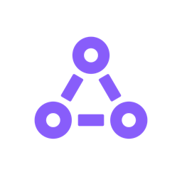

<h1 align="center">Oath Network</h1>

  <b>Ask in private. Get every answer under oath.</b> 
  Private AI you can check. The machine that answers cannot read your prompt, every answer comes back with a signed receipt, and witnesses who lie about a receipt lose their stake.

  <a href="https://oathnetwork.tech">Website</a> ·
  <a href="https://app.oathnetwork.tech">App</a> ·
  <a href="https://oathnetwork.tech/docs">Docs</a> ·
  <a href="https://x.com/OathNetworkRH">X</a>

  
  
  
  

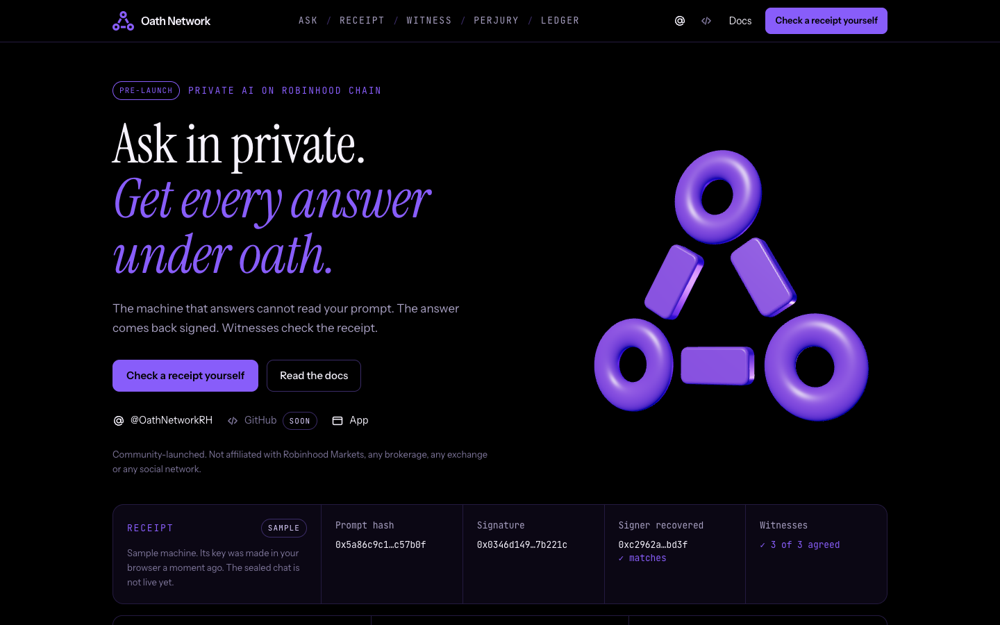

---

## About

People now type their most sensitive material into AI: trading plans, wallet lists, contracts before launch, legal drafts, health questions. The service on the other side can read all of it, and its promise not to look is a policy page, not a mechanism.

Oath Network treats privacy that cannot be checked as marketing. So the product is the check itself:

1. Your browser checks the sealed machine before it sends anything.
2. Your prompt is encrypted to a key that exists only inside that machine.
3. The machine answers inside a hardware enclave and signs the answer with its own key.
4. You get the answer and a receipt.
5. Three witnesses, drawn at random, check that receipt. Two of three must agree.
6. The receipt becomes public record on Robinhood Chain. The prompt never does.

The receipt is public. The prompt never is.

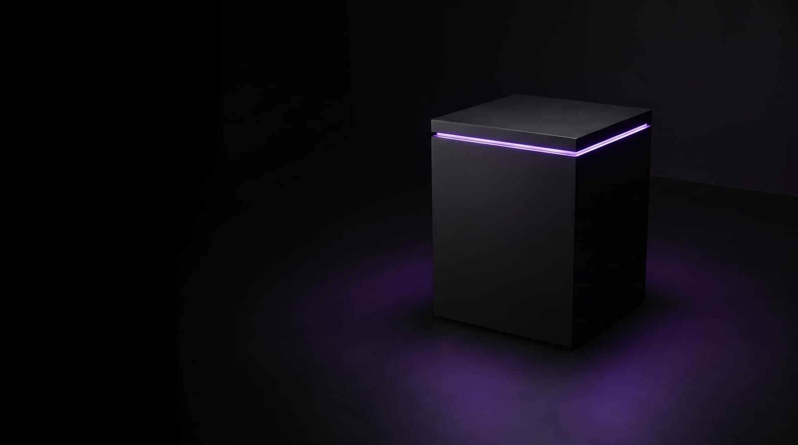

**Chain:** Robinhood Chain (EVM, chain id 4663) · **Ticker:** $OATH

---

## Features

### Sealed chat
- Five free sealed answers a day. No wallet, no signup.
- The browser checks the machine's proof against the public signer registry before it encrypts the prompt.
- The prompt is encrypted end to end (X25519, HKDF-SHA256, XChaCha20-Poly1305). The relay in the middle only ever sees ciphertext.
- No database table holds a prompt or an answer. There is nothing to leak, because it was never written.

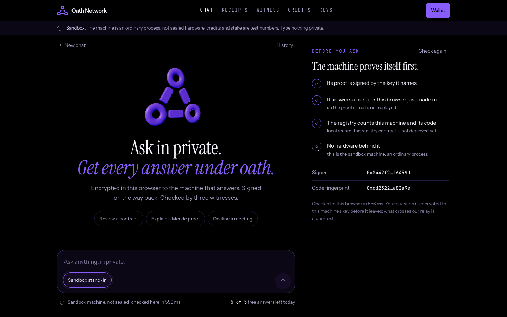

### Signed receipts
Every answer comes with a receipt on its own public page.

| In the receipt (public) | Never in the receipt |
|---|---|
| Receipt id and time | Your prompt |
| Model name | The answer text |
| Code fingerprint of the sealed machine | Who you are |
| Hash of the hardware attestation | |
| Hash of the answer, salted hash of the prompt | |
| The machine's signing address and signature | |
| Three witness signatures, once the round closes | |

Anyone can press **Check it yourself** on a receipt page and re-run the check in their own browser. A receipt can be shared without sharing the question.

<table>
  <tr>
    <td>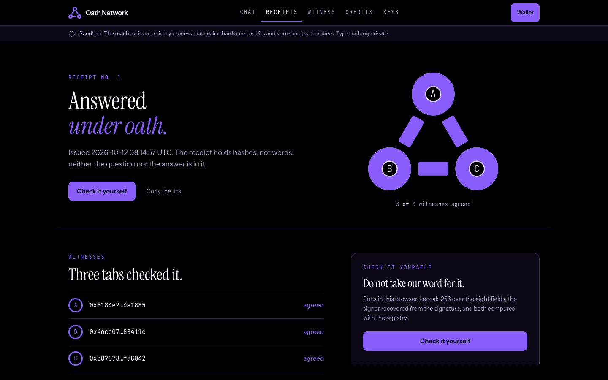</td>
    <td>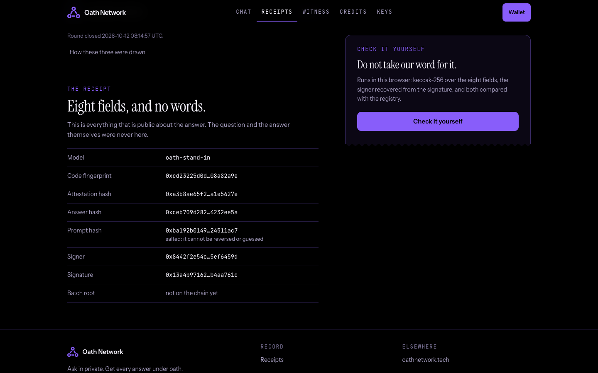</td>
  </tr>
  <tr>
    <td align="center">Receipt No. 1: answered under oath, 3 of 3 witnesses agreed</td>
    <td align="center">Eight fields and no words. Check it yourself.</td>
  </tr>
</table>

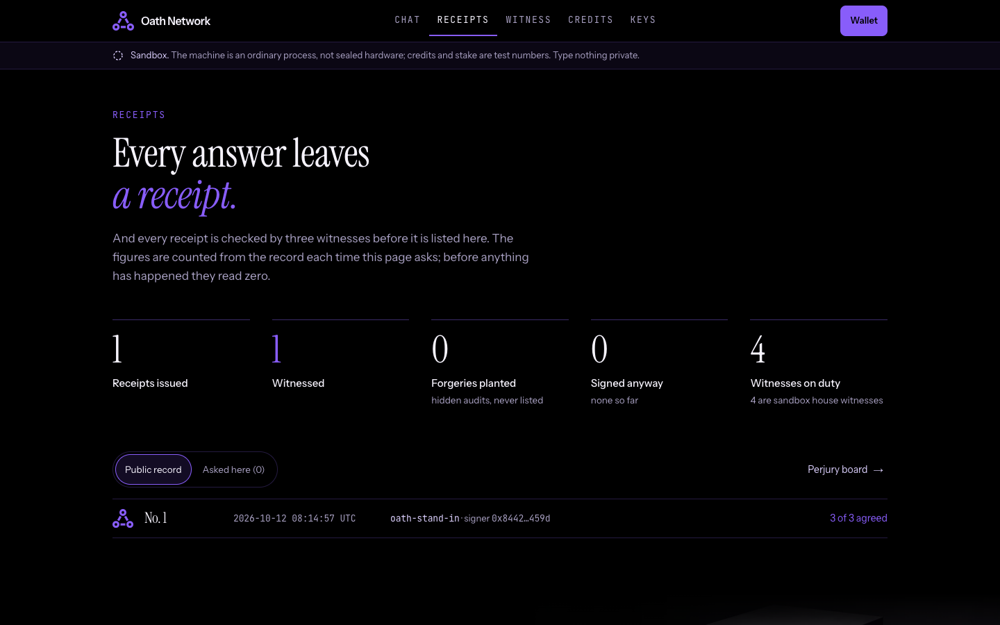

### Witness network

- Witnesses run in a browser tab. Each one recovers the signer, checks the code fingerprint against the registry, checks the attestation hash, and signs what it found.
- Witnesses are drawn from a public seed, so the operator cannot pick them, and a witness is never told who the other two are.
- **Planted forgeries:** one receipt in every twenty is a forgery planted on purpose. A witness that signs one has proven, with its own signature, that it did not check.
- **Cuts:** 10%, then 50%, then 100% of the stake. Half goes to the witnesses who checked correctly, half is burned.
- Witnesses are paid every hour for correct checks, with no fixed rate. Nothing is paid for simply holding.
- Public ranks based on clean checks in a row: Sworn, Steady, Trusted, Unbroken. A rank changes nothing about pay or the draw. It is a record.

<table>
  <tr>
    <td>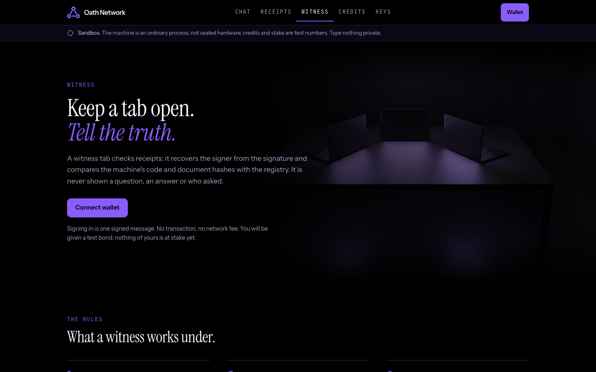</td>
    <td>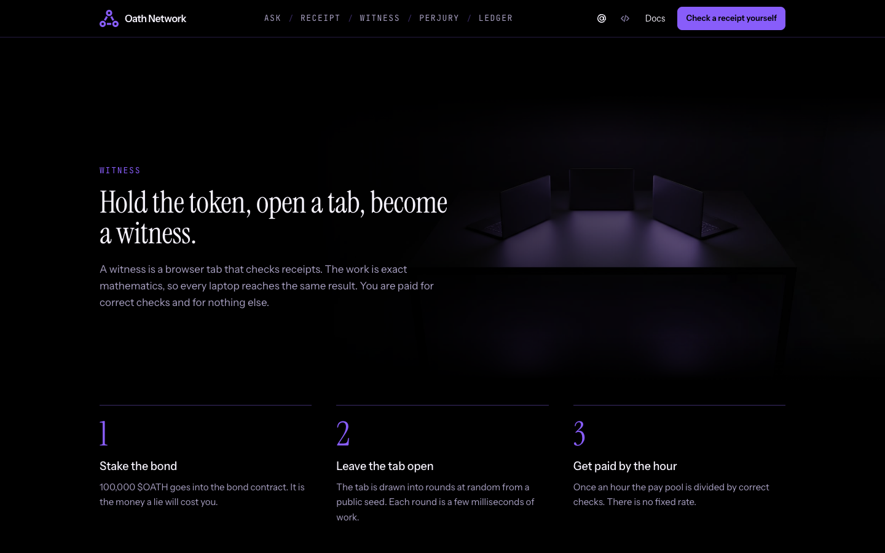</td>
  </tr>
  <tr>
    <td align="center">Keep a tab open. Tell the truth.</td>
    <td align="center">Stake the bond, leave the tab open, get paid by the hour</td>
  </tr>
</table>

Try the whole round in your browser on the landing page: a key signs a receipt, three witnesses recover the signer, and a forged receipt fails the check.

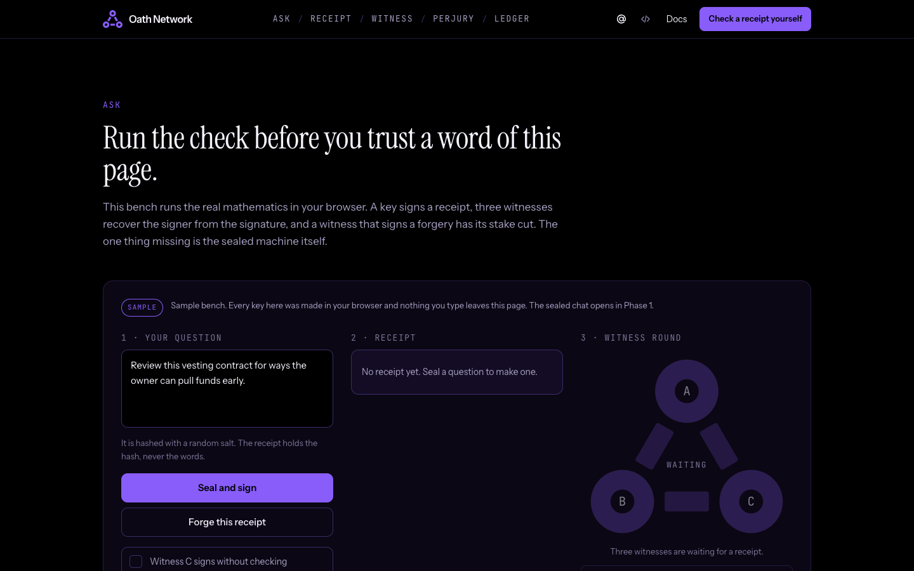

### The Perjury board
A public page listing every witness caught signing a forgery: the address, the forged receipt and what was wrong with it, the witness's own signature, the size of the cut and where it went. Each case has a button that re-checks the evidence in your browser.

<table>
  <tr>
    <td>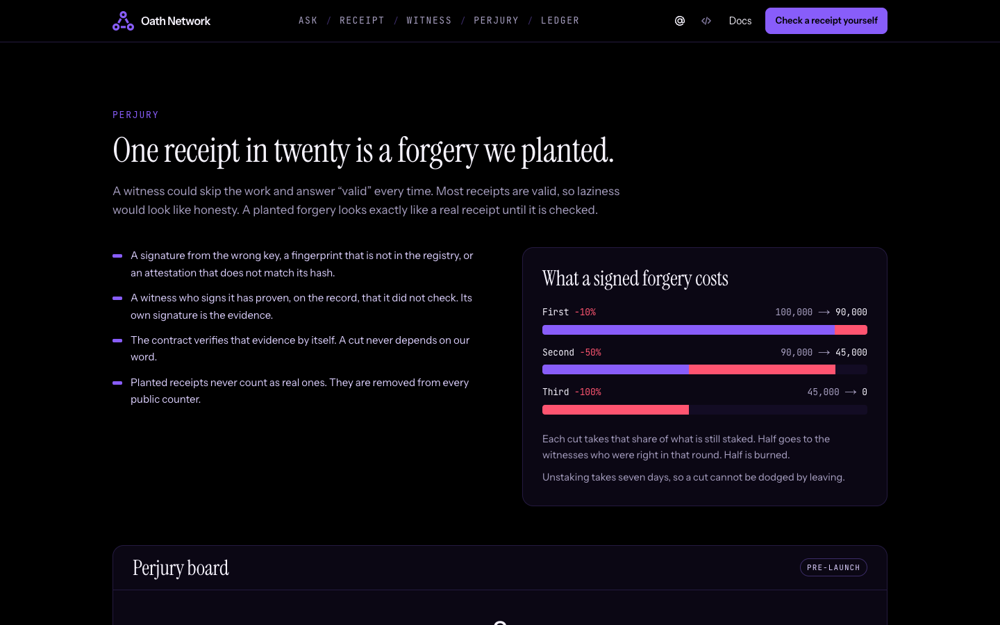</td>
    <td>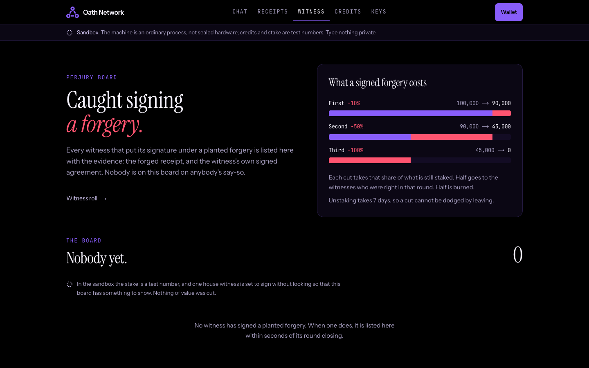</td>
  </tr>
  <tr>
    <td align="center">One receipt in twenty is a forgery we planted</td>
    <td align="center">The board: every cut, with the evidence</td>
  </tr>
</table>

### A vault with no keys
Every fee, from trading and from usage, lands in one vault with a fixed split and no owner, no pause, no upgrade and no withdraw path.

| Share | Goes to |
|---|---|
| 40% | Witness pay |
| 30% | Buyback and burn of $OATH |
| 20% | Upkeep |
| 10% | Breach pot |

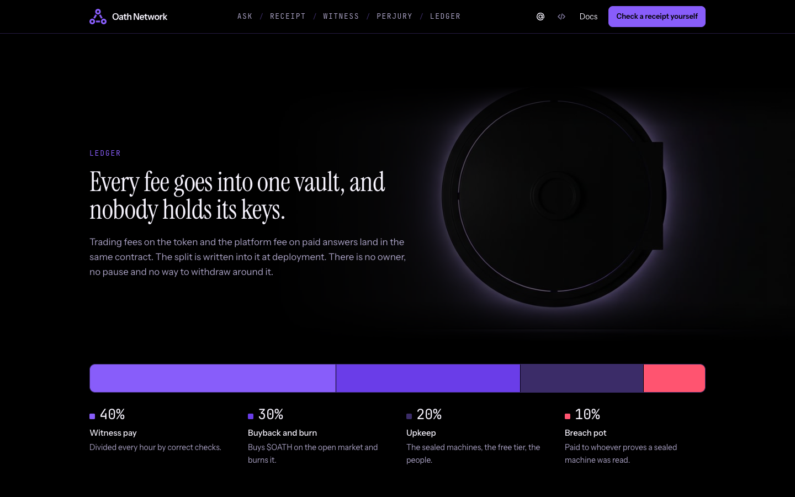

### Breach pot
Each sealed machine creates a random secret at start-up and publishes only its hash. Anyone who submits the secret itself is paid the pot by the contract. The only way to have it is to have read the machine's memory. The pot is a price tag on the hardware promise.

### For developers and agents
- Create an API key from the app with a wallet signature.
- Call the sealed lane over a standard chat completions API.
- Verify every answer in your own code: recover the signer and compare it with the registry.
- Public endpoints for receipts, counters and the signer registry, no key needed.

<table>
  <tr>
    <td>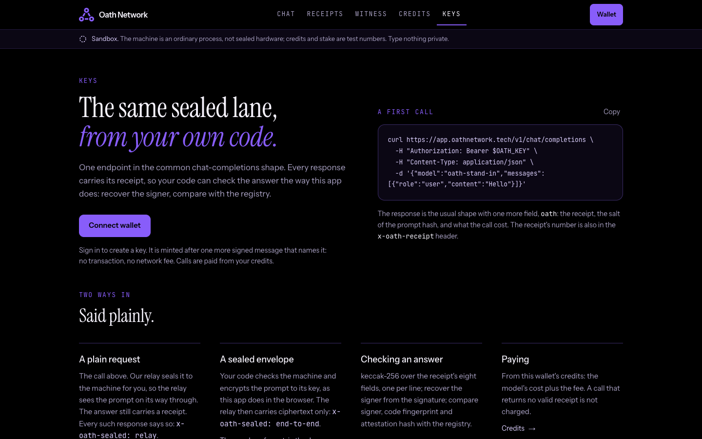</td>
    <td>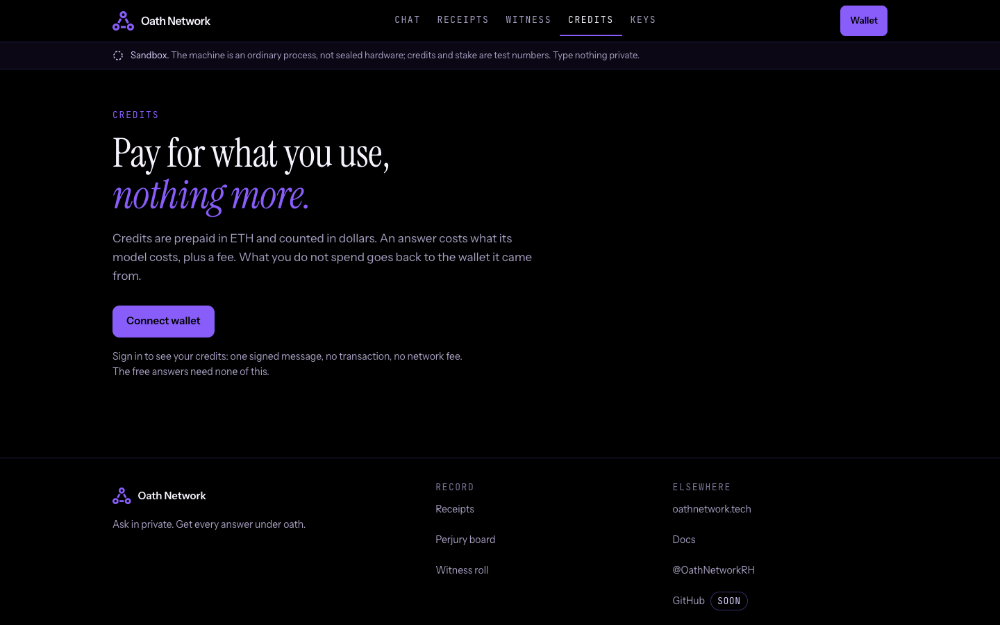</td>
  </tr>
  <tr>
    <td align="center">The same sealed lane, from your own code</td>
    <td align="center">Pay for what you use, nothing more</td>
  </tr>
</table>

### $OATH, the bond
$OATH is the stake a witness puts at risk, not a ticket.

| Tier | Requirement | Opens |
|---|---|---|
| Open | No wallet | 5 sealed answers a day, every receipt, every check |
| Holder | Hold 25,000 $OATH | 20 sealed answers a day, platform fee 10% instead of 20% |
| Witness | Stake 100,000 $OATH | Run a witness tab, paid per correct check, stake can be cut. 7-day exit |

What the token can never do: buy a different answer, buy a ruling, skip an audit, pay for sitting in a wallet, or vote. More stake does not mean being drawn more often.

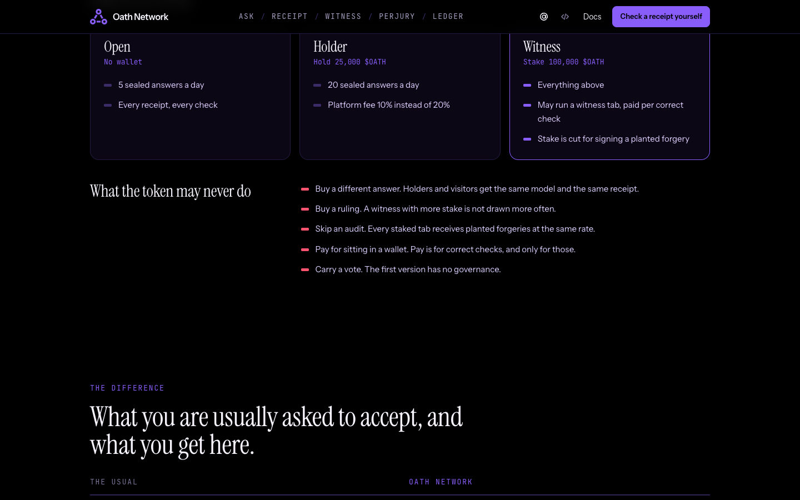

**Fair launch.** 1,000,000,000 supply, fixed, no mint. The team holds no supply: no allocation, no presale, no dev buy.

### Smart contracts
Seven Solidity contracts for Robinhood Chain, none with an owner over money:

| Contract | Role |
|---|---|
| `OathVault` | Receives every fee and splits it 40/30/20/10 |
| `OathBurner` | Buys $OATH back and burns it |
| `WitnessBond` | Stake, the 7-day exit, and cuts proven by a signed forgery |
| `WitnessPay` | Hourly pay epochs, published with a public delay |
| `BreachPot` | Pays whoever reveals a sealed machine's start-up secret |
| `SignerRegistry` | Which machine keys and code fingerprints count |
| `ReceiptLog` | One root per batch of witnessed receipts |

### On every screen
The app and the site are built for a phone first.

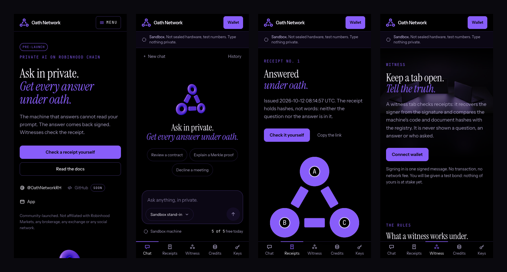

### Docs
Everything above, in full, at [oathnetwork.tech/docs](https://oathnetwork.tech/docs).

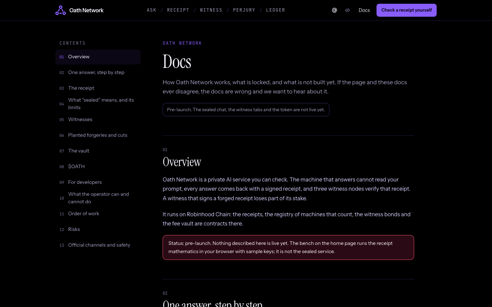

---

## What "sealed" means, and what it does not

**It means** the answer is produced inside a hardware enclave whose memory the machine's operator cannot read, the enclave proves which code it runs before it is given anything, and every answer is signed by a key born inside it.

**It does not mean** "cannot be broken". Enclaves rest on the chip maker, and published research has broken them with physical access to the server. We say hardware-attested, never more. A signed answer proves where it came from, not that it is true. And paying from a wallet is public on chain.

**v1 is not decentralised.** The coordinator is ours. We can delay or refuse an answer and choose which models are offered. We cannot pick the witnesses, cut a stake by decree, or move the vault's fees.

---

## Status

| Part | State |
|---|---|
| Website and docs | Live at [oathnetwork.tech](https://oathnetwork.tech) |
| App | Live at [app.oathnetwork.tech](https://app.oathnetwork.tech) as a **sandbox**: test credits, test stake, house witnesses. No model is connected yet, so answers are a fixed sentence. The sealed channel, the signed receipt and the witness check work as they will. |
| In-browser hardware attestation verifier | Not built yet |
| Contracts | Written and tested on a fork, **not deployed** |
| $OATH | **Does not exist yet.** Product first, token after. Any "$OATH" address shared today is not ours. |

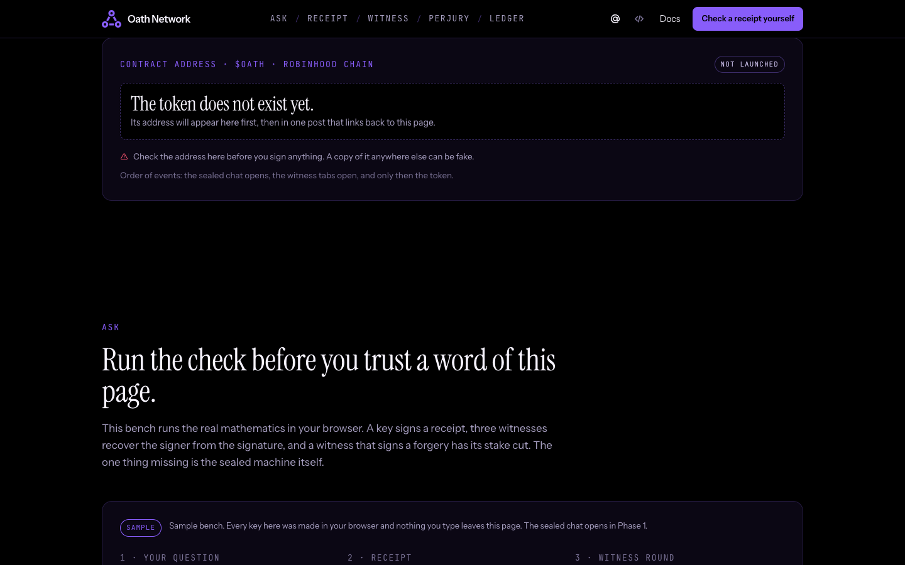

Official channels are X, GitHub and the docs. Nothing else is ours.

---

## Disclaimer

Oath Network is experimental software. Nothing here is financial advice or a promise of returns. $OATH is the stake that lets a witness work, and it can be cut.
